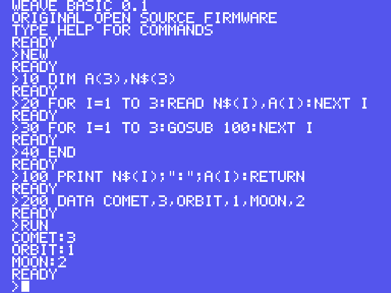
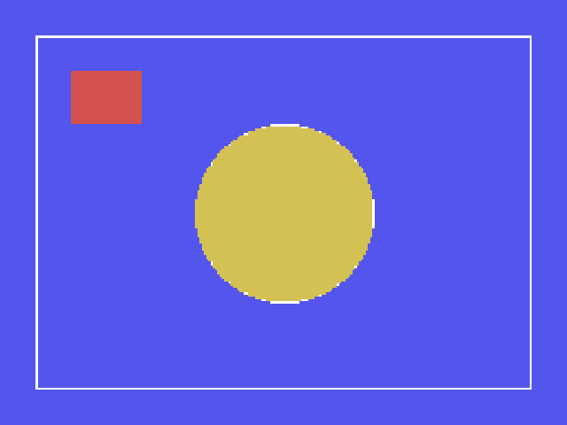

# Issue #17 post-merge verification

Completed on **2026-10-20 at 04:51:11 UTC** against the deployed site.

- Source: [Issue #17](https://github.com/takahirox/msx-rust/issues/17), confirmed open immediately before merging.
- PR: [#18](https://github.com/takahirox/msx-rust/pull/18).
- Reviewed PR head: `18d84b2603dcdc548f26333f412b27602d5cbd5c`.
- Merge commit: `c75428533433c67e0a10a41a77f6c584f1b9f956`, with parents `be1dd8baa0f48cc7a352fbbdc02868f207b5f719` and the reviewed PR head.
- Production workflow: [run 39371453814](https://github.com/takahirox/msx-rust/actions/runs/39371453814), completed successfully for that merge commit, including the build, automated checks and **Deploy GitHub Pages** job.
- Published URL: <https://takahirox.github.io/msx-rust/>.

## Observed live behavior

A fresh Chromium session loaded the production URL and booted MSX1 with status
`Running · Weave BASIC`, the original firmware banner and `READY`. Playwright typed
each numbered line of the repository's original examples through the focused
emulator display, then typed `RUN`.

The `scores.bas` example exercised numeric/string arrays, DATA/READ and GOSUB/RETURN.
Its transcript contained exactly this result followed by the prompt, and the
captured display visibly showed the same output:

```text
COMET:3
ORBIT:1
MOON:2
READY
```



The `shapes.bas` example visibly drew a white rectangle, a white circle with yellow
fill and a solid red rectangle on the blue SCREEN 2 background. Assertions sampled
the displayed Canvas pixels produced by the emulated VDP:

| Coordinate | RGB | Feature |
| --- | --- | --- |
| (16, 96) | (255, 255, 255) | LINE rectangle edge |
| (128, 56) | (255, 255, 255) | CIRCLE edge |
| (128, 96) | (212, 193, 84) | PAINT interior |
| (32, 32) | (212, 82, 77) | Filled LINE rectangle |
| (0, 0) | (84, 85, 237) | Background |



Both assertions and screenshot inspection passed. There were no page exceptions
or failed network requests. The production `msx_wasm.wasm` returned HTTP 200 with
SHA-256 `d07f09d2efcf859a6bf1009380d7e5182dd29ed5d8e0755b877b341bae02024e`.

This completes Issue #17's required post-merge Pages verification. No defects were
observed in these checks.
