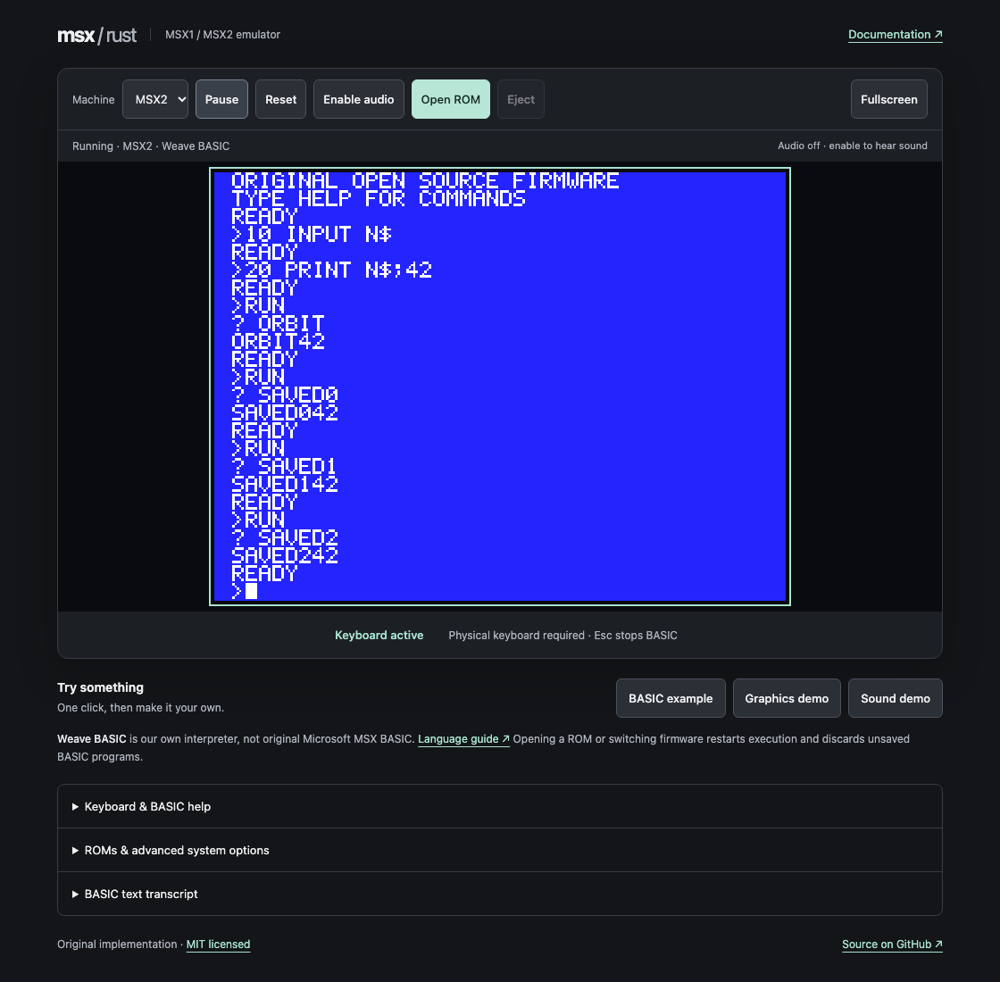
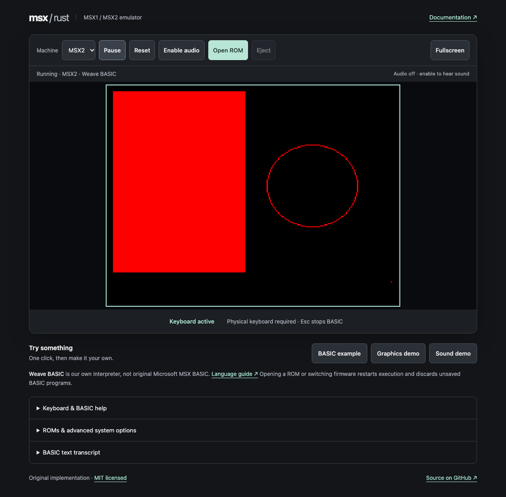

# MSX2 firmware and machine profile

MSX2 uses the same Rust CPU/VDP engine and independently authored Weave BASIC
interpreter as MSX1. Issue [#19](https://github.com/takahirox/msx-rust/issues/19)
makes both models start in automatic Weave BASIC with no cartridge. Opening a
supported cartridge switches to the model's C-BIOS before Z80 initialization;
Eject returns to fresh BASIC in the same model. Reset retains the cartridge,
mapper and active firmware policy. Selecting a machine manually clears all ROM
selections and restores automatic BASIC. Switching firmware discards the in-memory program.
C-BIOS is a separate cartridge BIOS, with no original Microsoft MSX BASIC.

## Built-in firmware and provenance

The bundled international/60 Hz pair is copied unchanged from the official
[C-BIOS 0.29a release](https://sourceforge.net/projects/cbios/files/cbios/0.29/).
`cbios_main_msx2.rom` (32 KiB) and `cbios_sub.rom` (16 KiB) form the MSX2 pair.
The same release supplies `cbios_main_msx1.rom` (32 KiB) for MSX1 cartridges.
No logo/extension ROM is needed for this profile's slot initialization, no-cartridge
message or verified cartridge boot. No original Microsoft/ASCII ROM, C-BIOS BASIC,
disk or music ROM, or proprietary game is distributed. Separately licensed
MSX1 games are available through [Demo ROMs](../README.md#demo-roms); their
[binary/asset audit](../demos/PROVENANCE.txt) records redistribution rights.

[CBIOS-PROVENANCE.txt](../firmware/cbios/CBIOS-PROVENANCE.txt) records the original
archive URL, exact version, archive and binary SHA-256 hashes, byte counts and
memory mapping. We verified the **License section included in that release's
`doc/cbios.txt`**, which explicitly permits binary redistribution when the notices,
conditions and disclaimer accompany it. [CBIOS-LICENSE.txt](../firmware/cbios/CBIOS-LICENSE.txt)
retains that complete section, including all nine copyright holders. These ROMs
remain BSD-2-Clause, separate from the emulator and original MIT test cartridges.
Both notices ship with the standalone ROM files and the Wasm binary in `dist/`;
[the inventory](../firmware/ROM-LICENSE.txt) identifies each asset. Builds, Rust tests
and browser tests use checked-in bytes and need no SourceForge connection.

The core embeds the firmware directly into Wasm. Automatic MSX2 cartridge boot starts at Z80 reset
with secondary selector 00h; C-BIOS discovers expanded slots, RAM and AB cartridge
headers itself. The normal browser path loads only local static app assets, with
no extra firmware fetch. There are no browser BIOS substitutes or native BIOS
traps. The Weave BASIC private service ports are disabled with C-BIOS.

Under **ROMs & advanced system options → Firmware policy**, explicitly selecting
C-BIOS, **Original diagnostic loader** or local firmware overrides automatic
switching. An override survives cartridge Open ROM, Reset and Eject. Selecting
a bundled override clears cartridge and staged local files. **Use Weave BASIC**
clears the override, ejects cartridges, and restores automatic behavior.

## Weave BASIC on MSX2

The same original interpreter, editor, cooperative execution, arrays, DATA,
GOSUB/RETURN, INPUT, SCREEN 0–3, graphics and PSG commands work on both models.
The private F0h/F1h services run only with active Weave BASIC, never with C-BIOS,
the diagnostic loader or local firmware. MSX2 BASIC maps expanded slot 3-3 RAM
and initializes its RAM selectors through Z80 I/O before using the stack. It also
initializes V9938 mode/scroll/sprite state for its display.

| SCREEN | Drawing coordinates | Colors |
| --- | --- | --- |
| 5 | x=0–255, y=0–211 | 0–15, V9938 power-on palette |
| 6 | x=0–511, y=0–211 | 0–3, first four palette entries |
| 7 | x=0–511, y=0–211 | 0–15, V9938 power-on palette |
| 8 | x=0–255, y=0–211 | 0–255, packed GRB (GGGRRRBB) |

PSET, LINE (including B/BF/STEP), CIRCLE and PAINT use packed bitmap VRAM and
clip outside these coordinates. COLOR sets default foreground and backdrop;
CLS clears bitmap VRAM to opaque zero. SCREEN initializes page zero, 212 lines,
no interlace, power-on palette and no sprites. Enter/Escape restores SCREEN 0.
The [README language guide](../README.md#weave-basic-and-firmware) defines the
shared semantics and bounds. SCREEN 4, bitmap PRINT/INPUT, screen variants,
interlace/pages and disk support are not implemented in the BASIC language;
this is not Microsoft MSX BASIC 2.0 compatibility.

```basic
10 SCREEN 7
20 LINE (8,8)-(503,203),15,B
30 CIRCLE (256,106),60,15
40 PAINT (256,106),10,15
50 END
RUN
```

Download the **original C-BIOS service-test cartridge** from advanced options and
open it through **Open ROM**. It displays `C-BIOS SERVICE TEST` through CHPUT, draws
an original striped tile at (0,16), and changes the adjacent tile from black to
white while Space is held. After enabling audio, Space also plays a ~440 Hz tone.
Before drawing, Z80 code verifies BIOS EXPTBL initialization, calls RDSLT/WRSLT
against protected sub-ROM slot 3-0 and RAM slot 3-3, and calls EXTROM INIPLT and
CHGMOD (which executes the sub-ROM). Video uses CHPUT/FILVRM/WRTVRM/WRTVDP;
keyboard and sound use SNSMAT/WRTPSG. The test needs real BIOS services and cannot
run on the diagnostic loader. No game identity or commercial compatibility is
inferred from this fixture.

## Try the original diagnostic

Choose **MSX2 diagnostic → Play demo** in Demo ROMs for a direct launch with
automatic model selection. Alternatively, under **ROMs & advanced system options**,
download **our original MSX2 diagnostic
cartridge**, then select it with **Open ROM**. It runs with C-BIOS or the original
diagnostic loader; no external firmware is needed.
It starts in SCREEN 7 (512×212), programs the extended palette, fills a page above
64 KiB, draws a line, copies a rectangle, transfers CPU data through a command,
and draws a mode-2 sprite. The color ramp is transferred from cartridge ROM by
Z80 instructions. Hold **8** briefly to select SCREEN 8 (256×212, 256 distinct
GRB colors); **7** restores SCREEN 7. Hold Space for a PSG tone after enabling
audio. Keyboard matrix and audio follow the same paths as MSX1.

Before drawing, the cartridge maps expanded slot 3-0 onto page zero and reads it.
With our diagnostic sub-ROM, it calls original Z80 code at 0100h, verifies its
return value and RAM signature, and restores the mappings. With other firmware,
it skips that private diagnostic routine. It also checks RTC banked storage.
The screen is generated by CPU instructions and emulated VDP operations; the
browser only transfers the Rust framebuffer to Canvas.

The optional **Original diagnostic loader** is the previous minimal AB loader and
diagnostic sub-ROM, with no BASIC prompt or standard BIOS services. With no
cartridge it waits on a blue backdrop. It is retained for isolated hardware tests.
All original generated ROMs are independently authored and MIT licensed; C-BIOS is
separately licensed as described above.


## VRAM storage and mode changes

The V9938 uses one stable 128 KiB backing store in physical bank order.
SCREEN 7/8 (GRAPHIC 6/7) decode a logical byte address `L` as
`((L >> 1) | ((L & 1) << 16)) & 0x1ffff`; the other supported modes
use linear decoding. For example, logical 00001h, 00002h and 10000h
select physical 10000h, 00001h and 08000h. Even and odd logical bytes
alternate between the two physical 64 KiB banks. SCREEN 7 packs two
pixels per logical byte; SCREEN 8 stores one GRB pixel per byte.

CPU prefetch/read-ahead and writes, bitmap drawing/rendering, sprite
attribute/color/pattern fetches and pixel/byte commands share this decoding.
The CPU counter stays logical: R14 carries at 16 KiB boundaries in extended
modes, with full 128 KiB wrapping; compatibility modes keep their selected
16 KiB bank. A register mode change preserves stored bytes and the buffered
read byte; subsequent memory accesses use the new mode. Reset retains its
existing buffer-reuse and VRAM-clearing behavior.

Weave BASIC bitmap primitives use the same pixel accessors. VPOKE now decodes
its logical address in the active mode, while retaining its supported decimal
0–16383 address bound. Console/font/tile operations use the supported linear
modes, and full bitmap CLS/SCREEN clears remain full-store clears. No BASIC
syntax, page-selection feature or address range was added.

The independently authored diagnostic now uploads two bytes through ports in
linear SCREEN 5, switches back without clearing, verifies buffered port readback,
and displays their SCREEN 7/8 interpretation at row 130 of display page 1.
Native regressions also inspect fixed physical addresses, both display pages,
scroll, alternate fields, sprite collision/overflow and logical/byte command
transfers, including overlapping reverse copies. The browser suite checks the
diagnostic pixels at both site roots.

Behavioral references:
[Yamaha V9938 Technical Data Book](https://www.dinoboards.com.au/assets/video-v9958/yamaha_v9938.pdf)
(printed pages 2–3, 7, 46–53 and command/sprite chapters),
[measured multi-bank addressing](https://openmsx.org/vdp-vram-timing/vdp-timing.html),
[openMSX CPU/table decoding](https://github.com/openMSX/openMSX/blob/master/src/video/VDP.cc)
and [command addresses](https://github.com/openMSX/openMSX/blob/master/src/video/VDPCmdEngine.cc).
Implementation and fixtures are original; no upstream code was copied.
VRAM arbitration, command speed/color corrections, expansion VRAM and exact
mid-command mode-change timing remain outside this correction. Commercial-title
compatibility and optional openMSX/hardware comparison remain unestablished.

## Firmware and memory profile

Use a lawfully obtained matching **32 KiB MSX2 main BIOS/BASIC ROM** and **16 KiB
MSX2 sub-ROM**. Select both local files under advanced options, then **Apply MSX2
firmware**. Selection stages the pair; applying validates both sizes, generation
byte 002Dh = 1 in the main ROM and the sub-ROM's `CD` header before changing the
running machine. MSX1, MSX2+ and combined/concatenated dumps receive an error.
Headers cannot prove provenance or compatibility between arbitrary ROM pairs.
Local firmware is not fetched automatically. Files stay in this tab's memory:
no network uploads, persistent storage or ROM contents in logs. Failed imports
leave active firmware, cartridge and banks intact. Reset retains the pair and
cartridge; applying a valid local pair restarts the current cartridge. Model switching or choosing built-in firmware releases it.

| Slot | Device | CPU address range |
| --- | --- | --- |
| 0 (unexpanded) | Main BIOS/BASIC | 0000h–7FFFh, ROM protected |
| 1 (unexpanded) | Existing plain/ASCII8/ASCII16/Konami/Konami SCC cartridge | Mapper dependent |
| 2 | Empty | Reads FFh |
| 3-0 | Sub-ROM | 0000h–3FFFh, ROM protected |
| 3-1, 3-2 | Empty | Reads FFh |
| 3-3 | 256 KiB RAM mapper | Four independently banked 16 KiB CPU pages |

A8h selects primary slots separately for each page. When page 3 selects expanded
primary slot 3, FFFFh reads the **inverted** secondary selector; writes set its
four per-page sub-slot fields, regardless of page 3's selected sub-slot. Otherwise
FFFFh belongs to the selected device. C-BIOS and local firmware begin with
secondary-slot selector 00h and discover RAM/slots themselves.
BIOS RDSLT/WRSLT/ENASLT/CALSLT routines execute as
Z80 code against these registers; there are no native BIOS traps. The profile
needs no disk, vendor extension, font or logo ROM to boot the verified cartridges.

### RAM mapper

One fixed 256 KiB mapper provides sixteen shared 16 KiB segments in slot 3-3.
Primary/secondary slot selection still gates every memory access. Selecting the
same segment on multiple pages aliases the same bytes; changing one selector
leaves the other three unchanged. Translation is `segment * 4000h + (address & 3FFFh)`.

| Low I/O port byte | CPU page |
| --- | --- |
| FCh | 0000h–3FFFh |
| FDh | 4000h–7FFFh |
| FEh | 8000h–BFFFh |
| FFh | C000h–FFFFh |

All high port bytes are ignored, consistently with existing I/O decoding. Writes
keep selector bits 0–3 and ignore bits 4–7; reads return `F0h | selected_segment`.
Ports operate while RAM is hidden. Memory FFFFh remains the inverted expanded-slot
register whenever primary slot 3 is selected on page 3, regardless of secondary
selection; I/O FFh is a separate mapper register. ROM protection and empty-slot
FFh reads are unchanged. MSX1 retains fixed 64 KiB RAM and FFh reads/ignored writes
at mapper ports. The core reserves its largest RAM buffer at creation so reset
and transactional model/firmware/cartridge commits do not allocate replacement RAM.

Hardware reset clears all RAM and resets **all selectors to zero**, before any
firmware executes. The original MSX2 Weave BASIC, diagnostic and disk reset loaders
execute a stack-free Z80 trampoline at 0080h that writes **3,2,1,0** to FCh–FFh
before entering their 0100h routines. See [assembly](../firmware/boot.asm) and
[byte generator](../crates/msx-core/src/firmware.rs). Bundled unmodified C-BIOS
0.29a discovers RAM and initializes the same selectors during actual CPU execution;
supplied firmware chooses its own values. There are no native BIOS traps or
firmware-specific hardware reset values. Readback/reset are this profile's contract,
not a claim that every physical mapper behaves identically.

The [original probe](../crates/msx-core/src/firmware/ram_mapper_fixture.rs) is generated
as `ram-mapper-test-cartridge.rom` (MIT). Open the advanced-options download with
**Open ROM** on MSX2: it verifies firmware initialization, then writes distinct
signatures at both ends of all sixteen segments before reading any back. A smaller
aliased capacity fails even if register readback claims sixteen segments. Z80
instructions draw `RAM MAPPER PASS` with a green bar, or `RAM MAPPER FAIL` with a red
bar, using the original font and VDP ports. MSX1 exercises the failure path.
Reset reboots the probe. No commercial ROM, proprietary firmware or host service
is used. Multiple mappers, configurable capacities/profiles and additional disk
firmware support are outside this task.

`tests/ram_mapper.rs` covers capacity through bus accesses, all pages/segments,
shared aliases, independent selectors, boundaries, masking/readback, hidden-slot
I/O, ROM/empty-slot isolation, FFFFh precedence, reset and original/supplied firmware
initialization, C-BIOS execution and failed-import preservation of selectors,
RAM, firmware, media and unsaved cartridge SRAM. Wasm disk boot status reads the
mapped CPU address, with a dedicated ABI regression. Existing tests observe RAM
through the bus. `tests/ram-mapper.spec.js` imports the probe with the ordinary ROM
picker at `/` and `/msx-rust/`, checks actual Canvas glyphs and the result bar,
Reset, failed import, authored local firmware and MSX1 failure. Existing BASIC,
input/audio, disk read/write/export and cartridge/SRAM suites remain mandatory.

The implementation and probe were independently authored from Issue #31's
behavioral contract. Relevant documentation: [MSX2 Technical Handbook I/O map](https://github.com/Konamiman/MSX2-Technical-Handbook/blob/master/md/Appendix6.md).
Existing C-BIOS bytes, licenses and provenance are unchanged.

### RTC

RTC ports B4h/B5h implement the RP-5C01 address latch, four banks of thirteen
nibble registers, common mode/test/reset registers, stopped/running time, 12/24-hour
counting and calendar rollover. Time begins at 1980-01-01 00:00:00 and advances
from emulated CPU cycles, not the host clock. Battery storage survives Reset and
cartridge/firmware changes in this session; model switching clears it. It is
never saved across reloads. Alarm data is readable/writable but the alarm output
is unwired. Test acceleration and external clock pulse outputs are not modeled.

## V9938 coverage and limits

- 128 KiB VRAM, R14 extended addressing and mode-dependent carry, read-ahead,
  ports 98h/99h, two-byte RGB palette port 9Ah, indirect register port 9Bh with
  auto-increment/inhibit, selected status registers, VBlank and line interrupts.
- Original TMS9918A text/tile/multicolor modes; V9938 80-column text with blink,
  SCREEN 4 and bitmap SCREEN 5–8, packed pixels, palette/direct color, 192/212
  lines, display pages, vertical scroll, display adjust and backdrop/blanking.
  Interlace weaves two fields into 384/424 rows; EO alternates display pages.
  PAL/NTSC selection changes emulated frame length and browser pacing.
- Mode-2 sprites: 8/16-pixel patterns, magnification, early clock, per-line colors,
  priority/color combination, ninth-sprite overflow, collision coordinates,
  sprite disable, SCREEN 6 tiling and SCREEN 8 fixed sprite colors.
- POINT, PSET, SRCH, LINE, LMMV/LMMM/LMCM/LMMC and HMMV/HMMM/YMMM/HMMC, logical
  IMP/AND/OR/XOR/NOT and their transparent variants, direction/edge handling,
  overlapping copies, CE busy and TR CPU-transfer handshakes, STOP and final
  coordinate/count registers. Work proceeds during CPU time, not status reads.
- The Wasm ABI exposes width, height and frame cycles. Canvas resizes on mode
  changes, recreates memory views and keeps a 4:3 display area with pixelated
  scaling, including the 512-pixel modes. Existing audio and input remain active.

Command timing is a deterministic approximation (one pixel/byte work unit per
eight CPU T-states), **not** V9938 arbitration timing. There is no VRAM contention,
cycle-exact horizontal blanking, analog overscan/composite output, digitizer,
superimposition, light pen, mouse color-bus interface or optional expansion VRAM.
Expansion VRAM reads FFh and ignores writes. Unsupported optional peripheral
ports read FFh. Raster effects depending on exact hardware timing, changing bitmap
layouts during an active command, undocumented mixed modes and edge-case sprite
priority are not compatibility guarantees. No MSX2+, turbo R, disk/tape drives,
SCC+/SCC-I, FM audio expansions, SRAM cartridges or game-specific patches are added.
Classic K051649 SCC audio is supported on both models; see [SCC details](scc.md).

Auto mapper inference uses the same local content analysis as MSX1 and never changes
the selected model. Estimates can be wrong; choose a documented mapper manually
and reopen the file when uncertain. See [the detection method](mapper-detection.md).

Successful mapper import only validates cartridge format and banking. It does
not prove that a game has booted. Commercial games, including Ganbare Goemon /
Samurai, have not been tested and are not guaranteed. Proprietary original
BIOS/BASIC has not been validated or distributed. None is needed for the automated
gates, and human gameplay is not an approval requirement.

## Verification

Run all [README verification commands](../README.md#development-and-verification).
`tests/msx2.rs` covers ports, status/interrupts, addressing, modes, pages, colors,
commands, transfers, slots, firmware validation, RTC, original CPU boot and reset.
The mapper CPU execution test runs in both profiles. `tests/msx2.spec.js` boots
actual Wasm through file inputs, reads Canvas pixels (including all 256 direct
colors), exercises Space/audio, mode changes/reset, paired/invalid imports,
MSX1 restoration, small screens and `/msx-rust/` hosting, and rejects upload
requests. The ordinary MSX1/MegaROM suite is retained.

The mandatory `tests/cbios.rs` tests boot the bundled main/sub pair and the
independent service-test cartridge, checking slot discovery, protected sub-ROM
reads/writes, expanded RAM, sub-ROM execution, VRAM text, real pixels, keyboard
return values, PSG samples/silence, invalid-load preservation, reset/eject and
firmware/model restoration. Existing mapper fixtures explicitly map both cartridge
pages instead of relying on the minimal loader's initial mapping; the default
C-BIOS path boots inferred ASCII8/ASCII16/Konami/Konami SCC fixtures in both Rust
and the browser. Indexed-branch and page-two AB-header tests retain their coverage.

`tests/msx2.spec.js` always runs the bundled C-BIOS service test at `/` and
`/msx-rust/` through the real file input. It checks Canvas pixels before/while/after
Space, nonzero audio and fresh silent buffers after settling, reset, a local
C-BIOS pair, invalid-pair preservation, the diagnostic loader, return to C-BIOS,
eject and MSX1 BASIC. It rejects external runtime requests and attempted persistent
storage, and asserts no upload/beacon requests or client errors. No environment
variables, user BIOS, manual firmware download or commercial ROM is required.
The separate diagnostic retains SCREEN 7/8, 212-line, sprite, command and 256-color
checks. Screenshots are saved as `test-results/cbios-services-root.png` and
`cbios-services-pages.png`, alongside the existing MSX2 diagnostic evidence.

`tests/boot_policy.rs` covers both models' automatic transitions, standard BIOS
services and input/video/audio, explicit overrides, invalid-import preservation,
MSX2 BASIC INPUT/arrays/DATA/subroutines/cooperative execution, joystick/PSG, and
SCREEN 5–8 packed drawing. `tests/allocation.rs` forces a real cartridge allocation
failure and denies allocation throughout firmware/cartridge/reset commits to
verify that reserved buffers suffice. Both main-ROM generations are checked.

`tests/boot-policy.spec.js` runs both models at both site roots through the real
Wasm application and Open ROM file picker. It checks BASIC program execution,
INPUT, invalid-load program preservation, visible SCREEN 0–3 and MSX2 SCREEN 5–8,
standard C-BIOS service pixels and keyboard input, Reset/Eject and explicit/local
firmware precedence. A deferred local pair and concurrent ROM import cannot undo
Eject. The browser regression suite also forces transfer-allocation/file-read
failures during BASIC, local firmware import and cartridge execution. Screenshots
are emitted as `test-results/basic-msx{1,2}-screen{mode}-{root,pages}.png`.

The older `check_bios` example remains available for optional lawfully obtained
local firmware testing; it is not needed by any automated gate:

```sh
cargo run --locked --release --example check_bios -- /local/main.rom /local/sub.rom
```

### Issue #35 validation

Validated locally on 2026-10-23, macOS arm64, pinned Rust 1.99.0, Node.js
24.12.0 and Playwright 1.64.1 / Chromium. Only original fixtures and the
unchanged bundled firmware/game assets were used.

| Check | Observed result |
| --- | --- |
| Baseline regression proof | All four new interleaving regressions and the new BASIC VPOKE regression fail with the original production VDP/command/BASIC code; restored implementation passes |
| `cargo fmt --all -- --check` | Passed |
| `cargo clippy --workspace --all-targets -- -D warnings` | Passed |
| `cargo test --workspace --locked` | All 135 tests passed |
| `./scripts/build.sh` | Passed using the existing documented macOS linker wrapper and pinned toolchain PATH |
| `node scripts/check-dist.mjs` | Passed, including the updated original diagnostic hash and provenance notice |
| `npm ci`; `npx playwright install chromium` | Passed |
| `npm test` | All 84 tests passed in 8.4 minutes, including cross-mode Canvas assertions at both site roots |
| `git diff --check`; changed JavaScript syntax | Passed |
| Optional openMSX/hardware comparison | Unperformed; openMSX is not installed and no hardware recording was used |

Initial test-authoring failures were corrected before the successful native run:
the BASIC test now waits for the scanline containing the changed pixels and
returns to text before entering its out-of-range VPOKE check. The deliberate
baseline failures above establish that same-mode port/renderer agreement cannot
conceal the original defect.

The source-Issue review covers physical storage, logical counters and buffered
reads, unchanged table-base masks and sprite color rules, all existing command
memory paths, BASIC direct consumers, the original Z80/browser probe, fixture
provenance and the complete diff. No blocking findings remain.
Issue #35 requires no post-merge verification; historical deployment checks
below remain separate.

### Issue #31 validation

Validated locally on 2026-10-23, macOS arm64, pinned Rust 1.99.0, Node.js 24.12.0 and
Playwright 1.64.1 / Chromium. Original fixtures and the unchanged bundled C-BIOS 0.29a
were used; no proprietary ROMs, physical hardware or human gameplay were required.

| Check | Observed result |
| --- | --- |
| `cargo fmt --all -- --check` | Passed |
| `cargo clippy --workspace --all-targets -- -D warnings` | Passed |
| `cargo test --workspace --locked` | 122 tests passed; mapper and Wasm status coverage added |
| `./scripts/build.sh` | Passed using the existing documented macOS linker wrapper; the initial unwrapped attempt failed to locate `libLLVM.dylib` |
| `node scripts/check-dist.mjs` | Passed; new original probe inventoried, pinned C-BIOS bytes/notices unchanged |
| `npm ci`; `npx playwright install chromium` | Passed |
| `npm test -- tests/ram-mapper.spec.js` | Two tests passed at root and project paths, including C-BIOS, Reset, authored local firmware and MSX1 failure |
| `npm test -- tests/browser.spec.js -g 'a reserved 2 MiB'` | One test passed, including rejection of a second cartridge allocation |
| `npm test` | Final run: all 84 tests passed in 8.3 minutes; initial run: 83 passed and the old allocation-test cap failed, corrected as described below |
| `git diff --check`; updated documentation file links; JavaScript syntax | Passed |
| Optional openMSX trace comparison | Unperformed: openMSX is not installed in this environment |

The constrained-memory browser regression now permits three additional 64 KiB
Wasm pages for the extra 192 KiB RAM reservation. It still verifies framebuffer
reuse, and explicitly rejects reserving a second 2 MiB cartridge copy.
The final probe screenshot was visually inspected: the PASS text and green bar
appear on a cleared display. Root/project-path screenshots are generated as
`test-results/ram-mapper-root.png` and `ram-mapper-pages.png`.

Repository review covered the complete diff against Issue #31: bus translation and
slot precedence, original-loader Z80 initialization, physical RAM consumers,
transactional/reset behavior, executable probes, browser import paths and
license/provenance preservation. No blocking implementation findings remain.
Issue #31 requires no post-merge verification; historical deployment checks below
remain separate.

### Issue #19 validation

Validated locally on 2026-10-20, macOS arm64, pinned Rust 1.99.0, Node.js
24.12.0, Playwright 1.64.1 / Chromium:

| Check | Observed result |
| --- | --- |
| Official C-BIOS 0.29a archive | Archive size/hash and all three ROM bytes/hashes verified; complete upstream License section matches the retained notice exactly |
| `cargo fmt --all -- --check` | Passed |
| `cargo clippy --workspace --all-targets -- -D warnings` | Passed |
| `cargo test --workspace --locked` | 82 tests passed, including both C-BIOS boot paths, BASIC bitmap/input/audio tests and forced allocation failure |
| `./scripts/build.sh` | Passed with the already documented macOS PATH/linker wrapper below; no toolchain or system changes |
| `node scripts/check-dist.mjs` | Exact 18-file inventory, all three C-BIOS hashes, notices, headers, relative links and import-free Wasm passed |
| `npm ci`; `npx playwright install chromium` | Passed |
| `npm test` | 43 tests passed in 3.9 minutes, including both models at root and project paths, allocation failures and deferred/concurrent imports |
| `npm test -- tests/boot-policy.spec.js` | Final five focused tests passed in 59.8 seconds after strengthening failed-load program execution assertions and capturing clean screenshots |
| `git diff --check`; local documentation links | Passed |

The full browser run preserves the original MSX1/MSX2 CPU, mapper, graphics,
PSG, privacy, responsive UI and deployment regressions. The focused boot-policy
suite also produces the BASIC mode screenshots below. Tests execute only original,
redistributable fixtures and bundled C-BIOS; no proprietary ROM or human gameplay
was used. The first local build selected Homebrew Rust 1.94 instead of the pinned
compiler; selecting the documented rustup PATH and linker wrapper resolved the
existing host setup issue. Required live Pages verification remains pending.




### Issue #15 validation

Validated locally on 2026-10-18, macOS arm64, pinned Rust 1.99.0, Node.js
24.12.0 and Playwright 1.64.1 / Chromium:

| Check | Observed result |
| --- | --- |
| Official archive and selected ROMs | Archive hash and both binary hashes match the pinned provenance record; bundled bytes match the archive exactly |
| Included upstream binary redistribution license | Complete copyright/conditions/disclaimer section verified against release `doc/cbios.txt`; preserved separately and copied unchanged to `dist/` |
| `cargo fmt --all -- --check` | Passed |
| `cargo clippy --workspace --all-targets -- -D warnings` | Passed |
| `cargo test --workspace --locked` | 63 tests passed, including the mandatory C-BIOS service/reset/firmware tests |
| `./scripts/build.sh` | Passed using the existing local macOS linker wrapper |
| `node scripts/check-dist.mjs` | Exact 16-file inventory, pinned ROM hashes, notices, headers, relative links and import-free Wasm passed |
| `npm ci`; `npx playwright install chromium` | Passed |
| `npm test` | 36 tests passed in 1.4 minutes, including both default C-BIOS service paths, four inferred MegaROM mappers, constrained-memory/reset checks and MSX1 regressions |
| `git diff --check`; local documentation links | Passed |

The existing macOS system-Rust PATH conflict and `rust-lld` library lookup failure
require the [documented local wrapper](deployment.md#pre-merge-validation); no
compiler/toolchain configuration or system installation was changed. The first
full browser run exposed an obsolete fixed memory cap in an MSX1 allocation
regression test: embedding the 48 KiB firmware consumes one more 64 KiB Wasm page.
The cap now accounts for that static data while remaining too small for the old
reset's replacement framebuffer. That regression passes. The service test checks
a whole original 8×8 striped tile so C-BIOS startup text cannot satisfy a reset
completion check; its screenshots were visually inspected after that refinement.
No proprietary firmware/game, subjective listening or manual gameplay is needed.

Specifications used for independent implementation:
[MSX2 Technical Handbook, VDP](https://konamiman.github.io/MSX2-Technical-Handbook/md/Chapter4a.html),
[commands](https://konamiman.github.io/MSX2-Technical-Handbook/md/Chapter4b.html),
[slots](https://konamiman.github.io/MSX2-Technical-Handbook/md/Chapter5b.html),
[RTC](https://konamiman.github.io/MSX2-Technical-Handbook/md/Chapter5a.html), and
[Yamaha/ASCII V9938 Technical Data Book](https://gr8bit.ru/rs/Documentation/V9938-programmers-guide.pdf).
No third-party emulator implementation or specification example program was copied.

## Required post-merge verification — pending

After merge, verify <https://takahirox.github.io/msx-rust/>. Record deployment
run, merged commit, live URL and observed outcome. In both models, start Weave
BASIC, run an original program with visible output, import the redistributable
service-test cartridge through Open ROM, verify C-BIOS execution, then Eject to
a usable BASIC prompt. Confirm deployed Wasm/assets and notices load without
errors. Local checks cannot prove publication. This remains pending; this node
does not push, open PRs, merge, comment or perform post-merge verification.
