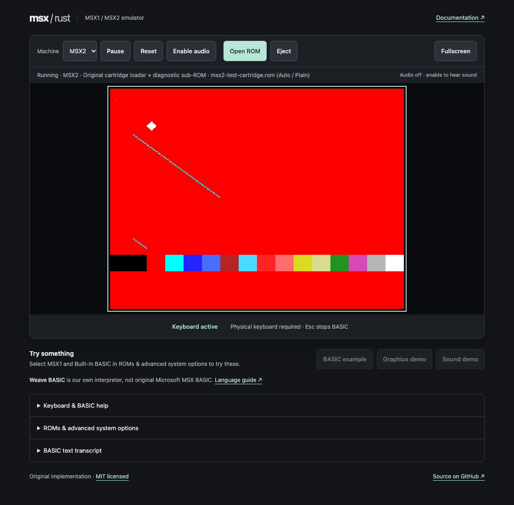
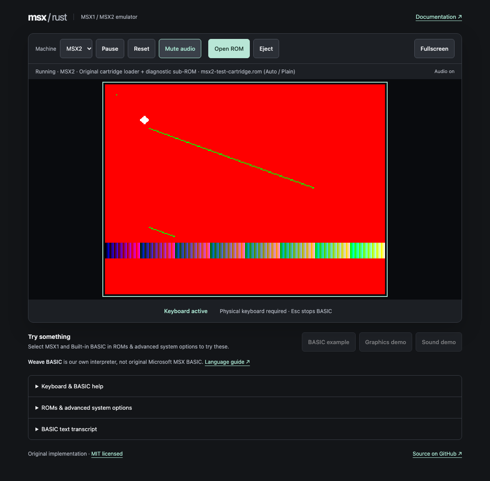

# Initial MSX2 machine

Issue [#11](https://github.com/takahirox/msx-rust/issues/11) adds MSX2 to the same
Rust machine/CPU/VDP engine as MSX1. Select **Machine → MSX2** in the toolbar.
Changing models clears incompatible ROM selections and resets the machine.
Reset keeps the active model, firmware pair and cartridge, and restores mapper
banks. MSX1 and its original Weave BASIC service remain available.

## Try the original diagnostic

Under **ROMs & advanced system options**, download **our original MSX2 diagnostic
cartridge**, then select it with **Open ROM**. No external firmware is needed.
It starts in SCREEN 7 (512×212), programs the extended palette, fills a page above
64 KiB, draws a line, copies a rectangle, transfers CPU data through a command,
and draws a mode-2 sprite. The color ramp is transferred from cartridge ROM by
Z80 instructions. Hold **8** briefly to select SCREEN 8 (256×212, 256 distinct
GRB colors); **7** restores SCREEN 7. Hold Space for a PSG tone after enabling
audio. Keyboard matrix and audio follow the same paths as MSX1.

Before drawing, the cartridge maps expanded slot 3-0 onto page zero and reads it.
With our diagnostic sub-ROM, it calls original Z80 code at 0100h, verifies its
return value and RAM signature, and restores the mappings. With other firmware,
it skips that private diagnostic routine. It also checks RTC banked storage.
The screen is generated by CPU instructions and emulated VDP operations; the
browser only transfers the Rust framebuffer to Canvas.

The built-in MSX2 firmware is a **minimal AB cartridge loader and diagnostic
sub-ROM**, not an MSX BIOS implementation and not MSX BASIC. It has no BASIC
prompt or standard BIOS entry-point services. With no cartridge, it waits on a
blue backdrop. Built-in MSX2 loader unloads external firmware and the cartridge.
Select MSX1 to use Weave BASIC. All five generated ROMs are independently authored
and MIT licensed; [the inventory](../firmware/ROM-LICENSE.txt) records their source.




## Firmware and memory profile

Use a lawfully obtained matching **32 KiB MSX2 main BIOS/BASIC ROM** and **16 KiB
MSX2 sub-ROM**. Select both local files under advanced options, then **Apply MSX2
firmware**. Selection stages the pair; applying validates both sizes, generation
byte 002Dh = 1 in the main ROM and the sub-ROM's `CD` header before changing the
running machine. MSX1, MSX2+ and combined/concatenated dumps receive an error.
Headers cannot prove provenance or compatibility between arbitrary ROM pairs.
No firmware is fetched automatically. Files stay in this tab's memory: no network
uploads, persistent storage or ROM contents in logs. Failed imports leave active
firmware, cartridge and banks intact. Reset retains the pair; model switching or
built-in mode releases it.

| Slot | Device | CPU address range |
| --- | --- | --- |
| 0 (unexpanded) | Main BIOS/BASIC | 0000h–7FFFh, ROM protected |
| 1 (unexpanded) | Existing plain/ASCII8/ASCII16/Konami/Konami SCC cartridge | Mapper dependent |
| 2 | Empty | Reads FFh |
| 3-0 | Sub-ROM | 0000h–3FFFh, ROM protected |
| 3-1, 3-2 | Empty | Reads FFh |
| 3-3 | 64 KiB RAM | Four 16 KiB pages |

A8h selects primary slots separately for each page. When page 3 selects expanded
primary slot 3, FFFFh reads the **inverted** secondary selector; writes set its
four per-page sub-slot fields, regardless of page 3's selected sub-slot. Otherwise
FFFFh belongs to the selected device. External firmware begins with selector 00h
and discovers RAM/slots itself. BIOS RDSLT/WRSLT/ENASLT/CALSLT routines execute as
Z80 code against these registers; there are no native BIOS traps. The profile
needs no disk, vendor extension, font or logo ROM to boot the verified cartridges.
It has fixed RAM, not a RAM mapper at FCh–FFh.

RTC ports B4h/B5h implement the RP-5C01 address latch, four banks of thirteen
nibble registers, common mode/test/reset registers, stopped/running time, 12/24-hour
counting and calendar rollover. Time begins at 1980-01-01 00:00:00 and advances
from emulated CPU cycles, not the host clock. Battery storage survives Reset and
cartridge/firmware changes in this session; model switching clears it. It is
never saved across reloads. Alarm data is readable/writable but the alarm output
is unwired. Test acceleration and external clock pulse outputs are not modeled.

## V9938 coverage and limits

- 128 KiB VRAM, R14 extended addressing and mode-dependent carry, read-ahead,
  ports 98h/99h, two-byte RGB palette port 9Ah, indirect register port 9Bh with
  auto-increment/inhibit, selected status registers, VBlank and line interrupts.
- Original TMS9918A text/tile/multicolor modes; V9938 80-column text with blink,
  SCREEN 4 and bitmap SCREEN 5–8, packed pixels, palette/direct color, 192/212
  lines, display pages, vertical scroll, display adjust and backdrop/blanking.
  Interlace weaves two fields into 384/424 rows; EO alternates display pages.
  PAL/NTSC selection changes emulated frame length and browser pacing.
- Mode-2 sprites: 8/16-pixel patterns, magnification, early clock, per-line colors,
  priority/color combination, ninth-sprite overflow, collision coordinates,
  sprite disable, SCREEN 6 tiling and SCREEN 8 fixed sprite colors.
- POINT, PSET, SRCH, LINE, LMMV/LMMM/LMCM/LMMC and HMMV/HMMM/YMMM/HMMC, logical
  IMP/AND/OR/XOR/NOT and their transparent variants, direction/edge handling,
  overlapping copies, CE busy and TR CPU-transfer handshakes, STOP and final
  coordinate/count registers. Work proceeds during CPU time, not status reads.
- The Wasm ABI exposes width, height and frame cycles. Canvas resizes on mode
  changes, recreates memory views and keeps a 4:3 display area with pixelated
  scaling, including the 512-pixel modes. Existing audio and input remain active.

Command timing is a deterministic approximation (one pixel/byte work unit per
eight CPU T-states), **not** V9938 arbitration timing. There is no VRAM contention,
cycle-exact horizontal blanking, analog overscan/composite output, digitizer,
superimposition, light pen, mouse color-bus interface or optional expansion VRAM.
Expansion VRAM reads FFh and ignores writes. Unsupported optional peripheral
ports read FFh. Raster effects depending on exact hardware timing, changing bitmap
layouts during an active command, undocumented mixed modes and edge-case sprite
priority are not compatibility guarantees. No MSX2+, turbo R, disk/tape drives,
SCC audio, SRAM cartridges or game-specific patches are added.

Auto mapper inference uses the same local content analysis as MSX1 and never changes
the selected model. Estimates can be wrong; choose a documented mapper manually
and reopen the file when uncertain. See [the detection method](mapper-detection.md).

Successful mapper import only validates cartridge format and banking. It does
not prove that a game has booted. Commercial games, including Ganbare Goemon /
Samurai, have not been tested and are not guaranteed. Proprietary original
BIOS/BASIC has not been validated or distributed. None is needed for the automated
gates, and human gameplay is not an approval requirement.

## Verification

Run all [README verification commands](../README.md#development-and-verification).
`tests/msx2.rs` covers ports, status/interrupts, addressing, modes, pages, colors,
commands, transfers, slots, firmware validation, RTC, original CPU boot and reset.
The mapper CPU execution test runs in both profiles. `tests/msx2.spec.js` boots
actual Wasm through file inputs, reads Canvas pixels (including all 256 direct
colors), exercises Space/audio, mode changes/reset, paired/invalid imports,
MSX1 restoration, small screens and `/msx-rust/` hosting, and rejects upload
requests. The ordinary MSX1/MegaROM suite is retained.

Optional local, legally redistributable C-BIOS verification (not bundled or fetched
by the app/tests; C-BIOS provides **no original MSX BASIC**):

```sh
cargo run --release --example check_bios -- /local/cbios_main_msx2.rom /local/cbios_sub.rom
MSX2_TEST_MAIN=/local/cbios_main_msx2.rom MSX2_TEST_SUB=/local/cbios_sub.rom npm test -- --grep 'local C-BIOS MSX2'
```

The Rust example boots our standard-port cartridge for 600 frames and checks
video, keyboard and audio. The optional browser case prepends original Z80 code
that calls external BIOS RDSLT and WRSLT against expanded sub-ROM/RAM before
running the MSX2 video diagnostic. A visible diagnostic proves those checks passed.
Only bounded CPU/register summaries are reported on failure, never ROM contents.

Actual local results on 2026-10-17 (macOS arm64, the repository's pinned toolchain,
Node 24.12.0, Playwright 1.64.1 / Chromium):

| Check | Observed result |
| --- | --- |
| `cargo fmt --all -- --check` | Passed |
| `cargo clippy --workspace --all-targets -- -D warnings` | Passed |
| `cargo test --workspace --locked` | 50 tests passed, including 15 MSX2 tests |
| `./scripts/build.sh` | Passed with the documented local linker wrapper |
| `node scripts/check-dist.mjs` | Exact eleven-file inventory, ROM headers/sizes, relative links and Wasm exports passed |
| `npm ci`; `npx playwright install chromium` | Passed |
| `npm test` | 31 tests passed; MSX1, MegaROM and MSX2 included |
| Full suite with `MSX2_TEST_MAIN` / `MSX2_TEST_SUB` | 32 tests passed in 23.6 seconds, including real C-BIOS RDSLT/WRSLT and MSX2 video boot |
| Local C-BIOS Rust example | 600-frame video/input/audio verification passed |

C-BIOS 0.29a was obtained separately from its official release for local verification;
no C-BIOS bytes or sources are committed. The package SHA-256 matched
`c585a2f4a10b397e460a95043d59ac79cf4442fbb45a6e14a1e27ef9febaed73`.
The initial build attempts exposed the existing system-Rust PATH conflict and
macOS `rust-lld` library lookup problem. Using the pinned toolchain and the
[already documented linker wrapper](deployment.md#pre-merge-validation) resolved
Wasm linking. The native release example also emitted a nonfatal `rust-objcopy`
debug-stripping warning for the same library path, then passed. No system
installation or repository compiler configuration was changed. The saved SCREEN
7/8 screenshots were visually inspected; they contain only our original fixture.

Specifications used for independent implementation:
[MSX2 Technical Handbook, VDP](https://konamiman.github.io/MSX2-Technical-Handbook/md/Chapter4a.html),
[commands](https://konamiman.github.io/MSX2-Technical-Handbook/md/Chapter4b.html),
[slots](https://konamiman.github.io/MSX2-Technical-Handbook/md/Chapter5b.html),
[RTC](https://konamiman.github.io/MSX2-Technical-Handbook/md/Chapter5a.html), and
[Yamaha/ASCII V9938 Technical Data Book](https://gr8bit.ru/rs/Documentation/V9938-programmers-guide.pdf).
No third-party emulator implementation or specification example program was copied.

## Required post-merge verification — pending

After merge, verify the actual GitHub Pages deployment at
<https://takahirox.github.io/msx-rust/>. Record its deployment run/commit and observed
URL, confirm relative Wasm loading, select MSX2 and boot the original diagnostic,
observe visible video and working controls. Local tests cannot establish that
publication succeeded. No push, PR, merge, comment or production verification is
performed by this implementation node; live failures should become follow-up Issues.
